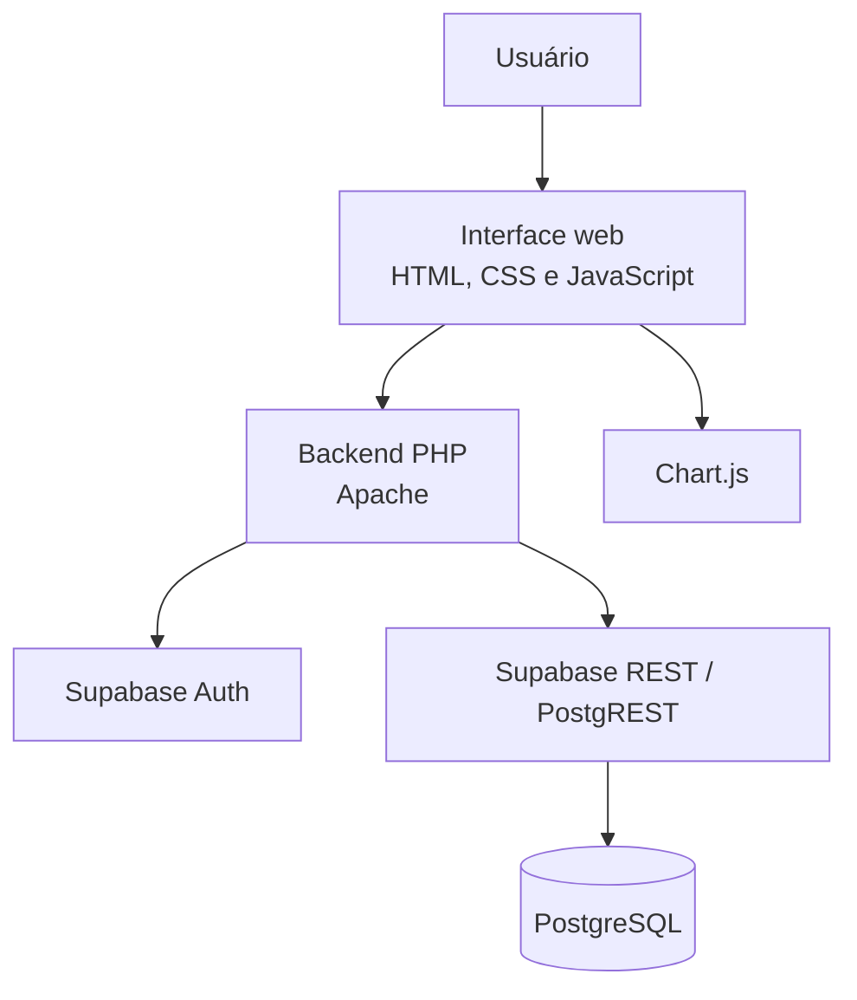

<div align="center">
  
  <h1>EduWatch</h1>
  <p><strong>Monitoramento do desempenho acadêmico de estudantes</strong></p>
  <p>Uma aplicação web para organizar informações acadêmicas e apoiar o acompanhamento pedagógico por meio de indicadores, gráficos e alertas.</p>
</div>

---

## Sumário

- [Sobre o projeto](#sobre-o-projeto)
- [Objetivos](#objetivos)
- [Funcionalidades](#funcionalidades)
- [Tecnologias utilizadas](#tecnologias-utilizadas)
- [Arquitetura](#arquitetura)
- [Estrutura do repositório](#estrutura-do-repositório)
- [Requisitos](#requisitos)
- [Instalação e execução local](#instalação-e-execução-local)
- [Configuração do Supabase](#configuração-do-supabase)
- [Perfis de acesso](#perfis-de-acesso)
- [Segurança e privacidade](#segurança-e-privacidade)
- [Regras de análise acadêmica](#regras-de-análise-acadêmica)
- [Limitações e estado do projeto](#limitações-e-estado-do-projeto)
- [Equipe](#equipe)

## Sobre o projeto

O **EduWatch** é um sistema web de acompanhamento do desempenho acadêmico. A aplicação reúne informações de notas, avaliações, frequência e acompanhamento pedagógico para facilitar a visualização da trajetória dos estudantes e apoiar decisões de professores e equipes de gestão escolar.

Em vez de apenas armazenar registros acadêmicos, o EduWatch organiza essas informações em painéis, indicadores, gráficos e alertas. Dessa forma, a equipe escolar pode observar resultados por aluno, turma, disciplina e período letivo, identificar situações que merecem atenção e acompanhar sua evolução.

O projeto está sendo desenvolvido por uma equipe de estudantes do **SENAI**, como uma solução educacional aplicada à organização e à análise de dados acadêmicos.

## Objetivos

- Centralizar informações acadêmicas relevantes para o acompanhamento dos estudantes.
- Facilitar a consulta de notas, avaliações e frequência.
- Apresentar indicadores e gráficos que ajudem a interpretar os dados ao longo dos períodos letivos.
- Apoiar a identificação de estudantes que possam precisar de acompanhamento pedagógico.
- Oferecer visões diferentes conforme o perfil de acesso: aluno, professor, coordenação e administração.
- Aplicar conceitos de desenvolvimento web, banco de dados, APIs, autenticação, segurança e visualização de dados.

## Funcionalidades

As funcionalidades são organizadas conforme o perfil de acesso.

### Área do aluno

- Visão geral do desempenho acadêmico.
- Consulta de médias e resultados por disciplina.
- Visualização da frequência por disciplina e do histórico de chamadas.
- Acompanhamento da evolução das médias por período letivo.
- Consulta de dificuldades e observações pedagógicas disponibilizadas ao estudante.
- Visualização dos dados do próprio perfil.

### Área do professor

- Visão geral das turmas e dos estudantes sob sua responsabilidade.
- Consulta e pesquisa de alunos.
- Criação e gerenciamento de avaliações.
- Retomada de avaliações em rascunho e lançamento de notas.
- Consulta de indicadores de desempenho das turmas.
- Registro e fechamento de frequência das aulas.
- Visualização de frequência por turma.
- Acompanhamento de estudantes em situação de atenção ou crítica.

### Área da coordenação

- Painel com indicadores gerais da escola.
- Consulta de alunos, professores e turmas.
- Gerenciamento de cadastros e atribuições de professores às combinações de turma e disciplina.
- Comparação de indicadores de desempenho e frequência por turma.
- Visualização da evolução acadêmica geral.
- Acompanhamento de alertas e registros pedagógicos.
- Configuração de regras de acompanhamento e consulta de relatórios.

### Área administrativa

- Acesso centralizado às áreas do sistema.
- Visualização das interfaces de aluno, professor e coordenação em modo de consulta, conforme as permissões implementadas.
- Ações administrativas restritas aos fluxos autorizados pelo backend.

> A disponibilidade de cada ação depende do perfil autenticado e das validações realizadas no servidor.

## Tecnologias utilizadas

| Camada                 | Tecnologia                | Utilização                                                                    |
| ---------------------- | ------------------------- | ----------------------------------------------------------------------------- |
| Estrutura da interface | HTML5                     | Organização das páginas e componentes da aplicação.                           |
| Estilização            | CSS3                      | Identidade visual, layouts e responsividade.                                  |
| Interatividade         | JavaScript                | Navegação, filtros, formulários, integração com APIs e atualização das telas. |
| Backend                | PHP 8.1 ou superior       | Autenticação, gerenciamento de sessão e comunicação com o Supabase.           |
| Banco de dados         | PostgreSQL (Supabase)     | Armazenamento dos dados acadêmicos e institucionais.                          |
| Autenticação           | Supabase Auth             | Autenticação das contas de usuário.                                           |
| API de dados           | Supabase REST / PostgREST | Consulta e persistência dos registros no PostgreSQL.                          |
| Gráficos               | Chart.js 4.x              | Visualização de médias, frequência e indicadores.                             |
| Servidor local         | Apache (XAMPP)            | Execução das páginas e dos endpoints PHP durante o desenvolvimento.           |
| Controle de versão     | Git e GitHub              | Histórico de alterações e colaboração da equipe.                              |

**Observação:** o projeto não utiliza Node.js, Express ou MariaDB na arquitetura atual. O banco de dados utilizado é PostgreSQL hospedado no Supabase, e o backend da aplicação é desenvolvido em PHP.

## Arquitetura

O EduWatch utiliza uma arquitetura web em que o navegador apresenta a interface, o backend PHP intermedeia as operações e o Supabase fornece autenticação e persistência dos dados.



### Fluxo geral

1. O usuário acessa a aplicação pelo navegador.
2. A interface envia as requisições necessárias aos endpoints PHP.
3. O backend valida a sessão e o perfil de acesso.
4. Quando autorizado, o backend consulta ou altera os dados no Supabase.
5. A resposta é devolvida à interface em formato JSON.
6. O JavaScript atualiza os componentes e os gráficos com os dados recebidos.

A sessão de autenticação é mantida no servidor por meio de cookie `HttpOnly`. As chaves secretas do Supabase são utilizadas exclusivamente no backend PHP e não devem ser inseridas nos arquivos JavaScript ou HTML.

## Estrutura do repositório

```text
EduWatch/
├── api/
│   ├── auth/                 # Endpoints de autenticação e sessão
│   └── academico/            # Endpoints de dados e operações acadêmicas
├── css/
│   ├── variables.css         # Variáveis e tokens visuais compartilhados
│   ├── dashboard.css         # Componentes e layout comuns dos painéis
│   ├── aluno.css             # Estilos da área do aluno
│   ├── professor.css         # Estilos da área do professor
│   ├── coordenacao.css       # Estilos da área da coordenação
│   ├── admin.css             # Estilos da área administrativa
│   ├── academico.css         # Componentes acadêmicos compartilhados
│   └── acompanhamento.css   # Acompanhamento pedagógico
├── img/                      # Logotipo e recursos visuais
├── js/
│   ├── auth.js               # Controle da sessão na interface
│   ├── components.js         # Componentes e comportamentos compartilhados
│   ├── charts.js             # Recursos reutilizáveis de gráficos
│   ├── aluno.js              # Comportamentos da área do aluno
│   ├── professor.js          # Comportamentos da área do professor
│   ├── coordenacao.js        # Comportamentos da área da coordenação
│   ├── admin.js              # Comportamentos da área administrativa
│   ├── avaliacoes.js         # Criação e gerenciamento de avaliações
│   ├── frequencia.js         # Registro de frequência pelo professor
│   ├── frequencia-aluno.js   # Consulta de frequência pelo aluno
│   ├── acompanhamento-pedagogico.js # Alertas e acompanhamento
│   ├── configuracao-regras.js # Regras pedagógicas
│   └── notificacoes.js       # Notificações da interface
├── .env.example              # Modelo de configuração do ambiente
├── .gitignore                # Arquivos e pastas ignorados pelo Git
├── .htaccess                 # Proteções básicas de acesso via Apache
├── index.html                # Tela de login
├── aluno.html                # Área do aluno
├── professor.html            # Área do professor
├── coordenacao.html          # Área da coordenação
├── admin.html                # Área administrativa
├── script.js                 # Comportamento da tela de login
├── style.css                 # Estilos da tela de login
└── README.md                 # Documentação do projeto
```

> A estrutura acima destaca os diretórios e arquivos centrais da aplicação. Novos módulos e arquivos podem ser adicionados durante o desenvolvimento.

## Requisitos

Para executar o EduWatch localmente, são necessários:

- Windows ou outro sistema operacional compatível com Apache e PHP.
- [XAMPP](https://www.apachefriends.org/pt_br/index.html), com Apache habilitado.
- PHP **8.1 ou superior**.
- Extensão **cURL** do PHP habilitada.
- Um projeto configurado no [Supabase](https://supabase.com/).
- Navegador atualizado.
- Conexão com a internet para acessar o Supabase e carregar o Chart.js pela CDN.
- Git, caso a instalação seja feita por meio do repositório.

O MySQL/MariaDB distribuído com o XAMPP não é utilizado como banco de dados pelo EduWatch. Os dados são armazenados no PostgreSQL do Supabase.

## Instalação e execução local

As instruções abaixo consideram Windows com XAMPP instalado no caminho padrão `C:\xampp`.

### 1. Clonar o repositório

Abra o terminal e execute:

```powershell
git clone https://github.com/Davi-Renan-Bender/EduWatch.git C:\xampp\htdocs\EduWatch
```

Se a pasta já existir, não clone novamente sobre ela. Entre na pasta existente e atualize o projeto de acordo com o fluxo Git utilizado pela equipe.

```powershell
cd C:\xampp\htdocs\EduWatch
```

### 2. Criar o arquivo de ambiente

Na raiz do projeto, copie o modelo:

```powershell
Copy-Item .env.example .env
```

Abra o arquivo `.env` e preencha as configurações do Supabase conforme a próxima seção.

### 3. Configurar o PHP

1. Abra o XAMPP Control Panel.
2. Na linha do Apache, abra `Config` e selecione `PHP (php.ini)`.
3. Verifique se a extensão cURL está habilitada. Se a linha estiver comentada, remova o `;` do início:

```ini
extension=curl
```

4. Salve o arquivo `php.ini`.
5. Reinicie o Apache para aplicar a configuração.

O projeto utiliza recursos de linguagem disponíveis no PHP 8.1 ou superior. Se o Apache estiver usando uma versão antiga do PHP, atualize a instalação antes de executar a aplicação.

### 4. Iniciar o Apache

No XAMPP Control Panel, clique em **Start** na linha do Apache.

Não é necessário iniciar o MySQL do XAMPP para utilizar o banco de dados remoto do Supabase.

### 5. Abrir o EduWatch

Acesse pelo navegador:

```text
http://localhost/EduWatch/index.html
```

**Importante:** abra o projeto pelo Apache, usando `localhost`. Não utilize a extensão Live Server do VS Code para executar as páginas, pois ela não processa os endpoints PHP.

## Configuração do Supabase

O backend lê as configurações do arquivo `.env`, localizado na raiz do repositório. O modelo `.env.example` contém os nomes das variáveis esperadas.

### Chaves atuais

```dotenv
SUPABASE_URL=https://SEU-PROJETO.supabase.co
SUPABASE_PUBLISHABLE_KEY=sb_publishable_SUA_CHAVE_PUBLICA
SUPABASE_SECRET_KEY=sb_secret_SUA_CHAVE_SECRETA
```

Preencha os valores com as informações do projeto Supabase utilizado pela equipe.

### Projetos com chaves legadas

Caso o projeto Supabase ainda utilize as chaves legadas, o backend também reconhece os nomes alternativos:

```dotenv
SUPABASE_URL=https://SEU-PROJETO.supabase.co
SUPABASE_ANON_KEY=SUA_CHAVE_ANON_PUBLICA
SUPABASE_SERVICE_ROLE_KEY=SUA_CHAVE_SERVICE_ROLE_SECRETA
```

Utilize o conjunto de variáveis correspondente às chaves disponíveis no projeto. Não compartilhe o conteúdo real do `.env` em mensagens, capturas de tela ou commits.

### Banco de dados e políticas

O Supabase deve conter o esquema PostgreSQL, as tabelas, os relacionamentos, as funções auxiliares e as políticas de segurança esperadas pelos endpoints do EduWatch. A configuração das credenciais, por si só, não cria automaticamente essas estruturas.

O repositório disponibiliza o arquivo `.env.example` como modelo de configuração; consulte a configuração do projeto Supabase utilizada pela equipe para obter o esquema e as políticas correspondentes.

## Perfis de acesso

O sistema organiza as experiências em quatro perfis principais:

| Perfil        | Finalidade                                                                                                  |
| ------------- | ----------------------------------------------------------------------------------------------------------- |
| Aluno         | Consultar o próprio desempenho, notas, frequência e informações de acompanhamento disponibilizadas.         |
| Professor     | Acompanhar turmas e alunos sob sua responsabilidade, criar avaliações, lançar notas e registrar frequência. |
| Coordenação   | Acompanhar indicadores institucionais, gerenciar cadastros e atribuições e configurar regras pedagógicas.   |
| Administração | Acessar as áreas do sistema em modo de visualização e utilizar os fluxos administrativos autorizados.       |

As contas são previamente provisionadas pela equipe autorizada. O projeto não disponibiliza cadastro público aberto. O acesso às operações é validado pelo backend e pelas permissões configuradas no banco de dados.

## Segurança e privacidade

- As chaves secretas do Supabase devem permanecer no backend e nunca devem ser publicadas no GitHub.
- O arquivo `.env` é ignorado pelo Git e protegido contra acesso direto pelo `.htaccess` incluído no projeto.
- O frontend consulta a sessão por meio de endpoint PHP; a sessão autoritativa fica no servidor em cookie `HttpOnly`.
- Os endpoints devem validar a sessão e o perfil antes de disponibilizar dados ou executar operações.
- As políticas de Row Level Security (RLS) do Supabase complementam as validações realizadas no backend.
- Não utilize dados pessoais ou credenciais reais em ambientes de demonstração sem autorização.

> A presença dessas medidas no código não representa, por si só, uma auditoria de segurança ou uma certificação para uso em produção. Antes de qualquer implantação institucional, é necessário revisar configuração do servidor, políticas do banco, permissões, backups, proteção de dados e procedimentos operacionais.

## Regras de análise acadêmica

O EduWatch utiliza regras e cálculos programados pela equipe para organizar e interpretar os registros acadêmicos.

**O projeto não utiliza Inteligência Artificial (IA) nem Machine Learning (ML).** Os indicadores e alertas são derivados das informações registradas e das regras pedagógicas configuradas no sistema.

Os resultados dependem da qualidade, da atualização e da consistência dos dados cadastrados. Um alerta é um recurso de apoio ao acompanhamento pedagógico e não substitui a avaliação dos profissionais da instituição.

## Limitações e estado do projeto

O EduWatch está em desenvolvimento como protótipo funcional e projeto educacional. Algumas funcionalidades, regras, relatórios e fluxos podem passar por ajustes conforme os testes da equipe.

- A aplicação requer conexão com o Supabase para autenticação e acesso aos dados.
- Os gráficos utilizam Chart.js carregado por CDN e, portanto, precisam de conexão com a internet.
- A execução local depende do Apache e de uma versão compatível do PHP.
- Para demonstrações, podem ser utilizados registros fictícios. Esses registros não devem ser interpretados como resultados acadêmicos reais.
- O projeto ainda não deve ser considerado um produto institucional pronto para implantação em produção.

## Equipe

Projeto desenvolvido colaborativamente por **três estudantes do SENAI**, na área de Informática para Internet.

O desenvolvimento envolve atividades de levantamento de requisitos, modelagem e organização de dados, construção da interface, implementação do backend, integração com o Supabase, testes e versionamento com Git e GitHub.

---

<div align="center">
  <strong>EduWatch</strong><br />
  <sub>Dados acadêmicos organizados para apoiar o acompanhamento pedagógico.</sub>
</div>
